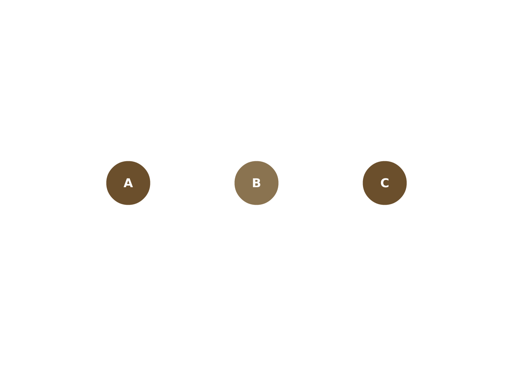

# Extending the ecosystem

The ecosystem is layered so that each layer exposes a seam the next one
builds on. The same seams are open to you. This article walks the four
most useful extension points, from the most local (a reusable piece of
drawing) to the most structural (making the whole ecosystem understand a
new kind of object).

## 1. Reusable drawing: grob factories and scene helpers

There are two ways to package a piece of drawing for reuse, and both are
ordinary R functions: nothing to register, nothing to teach the
renderer.

The first is a **grob factory**: a function that returns a single grob.
[`datashade()`](https://r-vellum.github.io/vellum/reference/datashade.html)
is exactly this: it returns one `raster_grob`, and a function that
returns a grob is a first-class primitive that drops straight into
[`draw()`](https://r-vellum.github.io/vellum/reference/vl_scene.html),
inherits graphical parameters from its viewport, and renders to every
backend.

The second, for drawing that is more than one primitive, is a **scene
helper**: a function that takes a scene, draws into it, and returns the
scene. Because
[`draw()`](https://r-vellum.github.io/vellum/reference/vl_scene.html)
takes one grob at a time, this is how you compose several primitives
into a reusable unit that still chains in a pipe:

``` r

# a labelled marker: a filled circle with text centred on it
marker <- function(scene, x, y, label, fill = "#6b4f2c") {
  scene |>
    draw(circle_grob(x = x, y = y, r = 0.06, gp = vl_gpar(fill = fill, col = NA))) |>
    draw(text_grob(label, x = x, y = y,
                   gp = vl_gpar(col = "white", fontface = "bold", fontsize = 12)))
}

vl_scene(4, 2, bg = "white") |>
  marker(0.25, 0.5, "A") |>
  marker(0.5, 0.5, "B", fill = "#8a7350") |>
  marker(0.75, 0.5, "C")
```



Scene-in, scene-out means your helper composes with
[`draw()`](https://r-vellum.github.io/vellum/reference/vl_scene.html),
[`push()`](https://r-vellum.github.io/vellum/reference/vl_scene.html),
and [`pop()`](https://r-vellum.github.io/vellum/reference/vl_scene.html)
like any built-in verb.

## 2. Custom themes: restyle without new machinery

At the grammar layer, a theme is a function that sets styling on a plot
spec. `vellumplot` gives you `theme()` for individual elements and
`set_theme()` for the common surfaces, built from `element_text()`,
`element_line()`, and `element_rect()`. A reusable theme is a function
that applies them:

``` r

theme_parchment <- function(plot) {
  plot |>
    set_theme(
      panel_bg  = "#faf5ea",
      grid_col  = "#e6dcc4",
      label_col = "#4a371f"
    ) |>
    theme(
      plot.title     = element_text(family = "serif", size = 16),
      legend.position = "bottom"
    )
}

vplot(mtcars) |>
  mark_point(x = wt, y = mpg, color = factor(cyl)) |>
  theme_parchment()
```

![]()

Since a theme is an ordinary verb in the pipe, it composes with
everything else and can be shared as a one-function package.

## 3. The interactivity contract

This is the seam that ties all three layers together, and the most
useful one to understand if you build tools on top. Interactivity is not
a feature of `vellumwidget` alone; it is a *contract* carried through
the scene:

- A `vellumplot` mark declares the reserved channels `tooltip`,
  `data_id`, `hover_group`, `hover_color`, and `selected_color`.
- Those are compiled onto the `vellum` grobs as their `key` (identity)
  and `meta` (the rest).
- `vellumwidget` reads them back out of the compiled scene (via
  [`scene_model()`](https://r-vellum.github.io/vellum/reference/scene_model.html))
  and wires up the widget.

The practical consequence: **you can make a bespoke `vellum` scene
interactive without touching `vellumwidget` at all**, just by attaching
`key` and `meta` to your grobs. Every primitive grob accepts them.

``` r

# a hand-built scene whose points are hoverable and selectable
s <- vl_scene(4, 3, bg = "white") |>
  push(vl_viewport(xscale = c(0, 10), yscale = c(0, 10))) |>
  draw(points_grob(
    x = vl_unit(c(2, 5, 8), "native"),
    y = vl_unit(c(3, 7, 4), "native"),
    gp = vl_gpar(fill = "#6b4f2c"),
    key = c("a", "b", "c"),                     # identity for selection
    meta = list(tooltip = c("Alpha", "Beta", "Gamma"))
  ))

as_widget(s)   # tooltips and selection work, no vellumplot involved
```

Because the contract lives in the scene, a mark you invent in
`vellumplot` that sets `tooltip`/`data_id` becomes interactive in
`vellumwidget` automatically, and a grob you build in `vellum` that sets
`key`/`meta` does too. Neither end has to know about the other.

## 4. Teach the ecosystem about your object

The deepest seam is
[`as_vellum_scene()`](https://r-vellum.github.io/vellum/reference/as_vellum_scene.html),
the S7 generic that every consumer calls to turn *something* into a
renderable scene. `vellumplot` registers a method for its plot spec;
that is how
[`render()`](https://r-vellum.github.io/vellum/reference/vl_scene.html)
and `as_widget()` accept a `vellumplot` plot at all. If you have your
own object (a model, a spatial structure, a domain-specific plot type),
you can register a method that compiles it into a `vellum` scene, and
from that moment it renders and becomes interactive through the same
machinery as everything else.

``` r

library(S7)

# a tiny custom object
my_plot <- function(data) structure(list(data = data), class = "my_plot")

# teach the ecosystem how to compile it into a vellum scene
method(as_vellum_scene, new_S3_class("my_plot")) <- function(x, ...) {
  vl_scene(4, 3, bg = "white") |>
    push(vl_viewport(xscale = range(x$data$x), yscale = range(x$data$y))) |>
    draw(points_grob(vl_unit(x$data$x, "native"), vl_unit(x$data$y, "native"),
                     gp = vl_gpar(fill = "#6b4f2c")))
}

p <- my_plot(data.frame(x = 1:10, y = (1:10)^2))

render(p, "custom.png")   # works: render() compiles via as_vellum_scene()
as_widget(p)              # works: vellumwidget compiles via the same seam
```

Registering that one method is what makes
[`render()`](https://r-vellum.github.io/vellum/reference/vl_scene.html),
`render_plot()`, and `as_widget()` all accept your object; they never
see `my_plot`, only the scene it compiles to.

## The picture

The four seams line up with the four layers of reuse:

| you want to reuse | the seam | where it lives |
|----|----|----|
| a piece of drawing | a function returning grobs | `vellum` |
| a look | a function applying `theme()`/`set_theme()` | `vellumplot` |
| interactivity | `key`/`meta` on grobs; `tooltip`/`data_id` on marks | the scene contract |
| a whole new plot type | an [`as_vellum_scene()`](https://r-vellum.github.io/vellum/reference/as_vellum_scene.html) method | the compiler seam |

Each is independent: a composite grob needs no theme, a theme needs no
custom object, and a custom object gets rendering and interactivity for
free the moment it can produce a scene. That independence is the point
of splitting the ecosystem into layers. See [the vellum
ecosystem](https://r-vellum.github.io/vellumverse/articles/ecosystem.md)
and [vellum’s design
principles](https://r-vellum.github.io/vellumverse/articles/design-principles.md)
for the reasoning behind the split.
